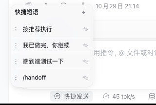

# dsh-quick-reply

Adds a quick-send button to the DeepSeek Harness composer. Save the phrases you
keep retyping, then send any of them to the current session with one click.

English | [中文](README.zh.md)



## What it does

- **One-click send.** Clicking any phrase in the panel sends it as a message to
  the current session and collapses the panel.
- **Skill shortcuts.** A phrase may contain `/skill-name`, which is equivalent to
  typing that skill by hand. While adding a new phrase, or editing one that already
  contains a `/skill-name` token, type `/` or press the `/` button to list the skills
  available in the current session. A phrase without such a token stays plain text:
  no `/` button, no candidate list.
- **Custom order.** Hold `⋮⋮` and drag up or down to reorder.
- **Edit in place.** ✎ edits a phrase, `🗑` deletes it, `✓` saves, `✕` cancels.
- **Add any time.** The `+` in the panel's top-right corner appends an entry
  (at most 20 phrases, 2000 characters each).

Four phrases ship by default: `按推荐执行`, `我已做完，你继续`, `端到端测试一下`, and
`/handoff` (the last one is a skill shortcut and only fires when the session has a
`handoff` skill).

## Install

Requires DSH `>=0.2.1-0 <0.3.0`. Install through `dsh plugin`, replacing
`--profile` with the instance you use (`web` or `desktop`):

```sh
dsh plugin --profile web add dsh-quick-reply
```

Afterwards restart that instance (`dsh web` or the desktop app), then hard-refresh
the browser (Cmd/Ctrl+Shift+R).

Update to the latest version:

```sh
dsh plugin --profile web add dsh-quick-reply@latest
```

Uninstall:

```sh
dsh plugin --profile web remove dsh-quick-reply
```

## Usage

- Phrases live in the **current browser's** `localStorage` (key
  `dsh-quick-reply:items:v1`); they are **not synced across browsers or devices**.
  Switching browsers or clearing site data means adding them again.
- The skill list comes from the current session, so the available skills change
  when you switch sessions.
- A mistyped skill name does not raise an error: the text is sent as plain text.

## Caveats

- Clicking a phrase sends its content straight as a message, exactly as if you had
  typed it yourself — there is no extra confirmation step.
- The plugin only sends text; it never runs commands on your behalf.

---

## Development

The rest of this document is for plugin developers.

### Layout

| File | Purpose |
|---|---|
| `client.js` | Browser-side UI bundle: dock button, panel, editing, drag-reorder, skill suggestions |
| `index.js` | Host-side no-op plugin that only declares its name |
| `cordis.patch.yml` | Bundle patch, declared by `dsh.bundle.patch` in `package.json` |
| `locale/{en,zh}.json` | Plugin title and description |
| `client.test.mjs` | `node --test` cases |

### Dependencies

- Skill suggestions come from the optional `remote.skills` service (`skills/list`),
  read directly with `scope.get('remote.skills')`. When that service is
  unavailable the plugin still works — you just get no suggestion list, and typing
  `/name` by hand still works.
- Messages are sent through the session's `conversation` service, `send(text)`.

### Local debugging

```sh
dsh plugin --profile web add /absolute/path/to/dsh-quick-reply
```

Editing `client.js` hot-swaps on save: the host's built-in client HMR polls the
loaded client assets every 500 ms (`{mtimeMs, ctimeMs, size}`), pushes a `rebuilt`
frame over `/plugins/events`, and the browser swaps that plugin's bundle. **No
instance restart and no page refresh is needed** (the bundle reload resets that
plugin's front-end state). If a change does not show up, retry from
Settings → Plugins.

The host half (`index.js`) is outside that HMR path, so restart the instance after
changing it.

### Tests

```sh
npm test
```

The tests evaluate `client.js` in Node with a stub loader. They cover storage
normalization, reordering, `/name` syntax parsing and filtering, and dock
registration with or without the optional skills service behind a guarded Remote facade.

Before releasing, check the publish manifest with `npm pack --dry-run`: every
runtime file must be listed (both READMEs included) and test or temporary files
must not be.

### Release

A tag triggers CI to publish to npm (Trusted Publishing, with provenance):

```sh
# edit package.json's version so it matches the tag
git commit -am "chore: release X.Y.Z"
git push origin master
git tag vX.Y.Z && git push origin vX.Y.Z
```

CI creates a GitHub Release afterwards.
