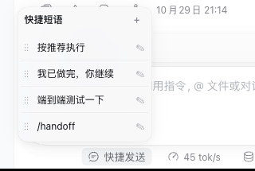

# dsh-quick-reply

在 DeepSeek Harness 的会话输入区加一个「快捷发送」按钮。把常用的话术存成短语，点一下就发到当前会话，不用每次重新输入。

[English](README.md) | 中文



## 能做什么

- **一键发送**：点击面板里的任意一条短语，它会作为一条消息发到当前会话，面板随即收起。
- **技能快捷方式**：短语里可以写 `/技能名`，等价于手动输入这个技能。添加或编辑时输入 `/` 或点 `/` 按钮，会列出当前会话可用的技能供选择。
- **自定义顺序**：按住 `⋮⋮` 上下拖动即可调整顺序。
- **就地编辑**：点 ✎ 修改短语，`🗑` 删除，`✓` 保存，`✕` 取消。
- **随时添加**：面板右上角的 `+` 在末尾新增一条（最多 20 条，每条不超过 2000 字）。

默认提供四条：`按推荐执行`、`我已做完，你继续`、`端到端测试一下`、`/handoff`（最后一条是技能快捷方式，需要会话里存在 `handoff` 技能才会生效）。

## 安装

需要 DSH `>=0.2.1-0 <0.3.0`。通过 `dsh plugin` 安装，把 `--profile` 换成你使用的实例（`web` 或 `desktop`）：

```sh
dsh plugin --profile web add dsh-quick-reply
```

安装后重启对应的实例（`dsh web` 或桌面应用），然后在浏览器里强制刷新（Cmd/Ctrl+Shift+R）。

更新到最新版本：

```sh
dsh plugin --profile web add dsh-quick-reply@latest
```

卸载：

```sh
dsh plugin --profile web remove dsh-quick-reply
```

## 使用说明

- 短语保存在**当前浏览器**的 `localStorage` 里（key 为 `dsh-quick-reply:items:v1`），**不跨浏览器、不跨设备同步**。换浏览器或清除站点数据后需要重新添加。
- 技能列表来自当前会话。切换会话后可用的技能会跟着变化。
- 写错的技能名不会报错，会按普通文本原样发出去。

## 注意

- 点击短语时，内容会直接作为消息发送，与你手动输入一样，不会经过额外的确认。
- 插件只负责发送文本，不会替你执行任何命令。

---

## 开发

以下内容面向插件开发者。

### 结构

| 文件 | 作用 |
|---|---|
| `client.js` | 浏览器端 UI bundle：停靠按钮、面板、编辑、拖拽排序、技能候选 |
| `index.js` | host 侧的空插件，仅声明名称 |
| `cordis.patch.yml` | bundle patch，由 `package.json` 的 `dsh.bundle.patch` 声明 |
| `locale/{en,zh}.json` | 插件标题与描述 |
| `client.test.mjs` | `node --test` 用例 |

### 依赖

- 技能候选来自 `remote.skills`（`skills/list`）。该服务不可用时插件仍然可用，只是没有候选列表，手动输入 `/name` 依然有效。
- 发送消息通过会话的 `conversation` 服务的 `send(text)`，以 `queue` 模式提交。

### 本地调试

```sh
dsh plugin --profile web add /absolute/path/to/dsh-quick-reply
```

改动 `client.js` 保存即热替换：宿主自带的 client HMR 每 500 ms 轮询已加载的 client 资源（`{mtimeMs, ctimeMs, size}`），变化后经 `/plugins/events` 推 `rebuilt`，浏览器替换该插件的 bundle——**不需要重启实例，也不需要刷新页面**（bundle 重载会重置该插件的前端状态）。没生效就去「设置 → 插件」重试。

host 半（`index.js`）不在这套 HMR 范围内，改完需要重启实例。

### 测试

```sh
npm test
```

测试在 Node 中以桩 loader 求值 `client.js`，只覆盖导出的纯函数：存储规范化、顺序调整、`/name` 语法解析与筛选。

发布前用 `npm pack --dry-run` 核对发布清单：运行时文件一个不少（两份 README 都在内），测试与临时文件一个不多。

### 发布

版本由 tag 触发 CI 发布到 npm（Trusted Publishing，带 provenance）：

```sh
# 修改 package.json 的 version，使其与 tag 一致
git commit -am "chore: release X.Y.Z"
git push origin master
git tag vX.Y.Z && git push origin vX.Y.Z
```

发布后 CI 会创建 GitHub Release。
